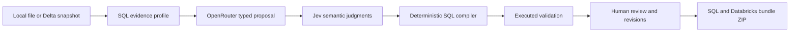

# Silverline

Turn raw-table evidence into reviewable, tested Silver pipeline proposals.

A local, single-user POC built with TanStack Start, React Query/server functions, shadcn-style Radix components, Effect v4, DuckDB, SQLite, TypeSafe Jev, and OpenRouter. It starts with synthetic data and includes a Databricks adapter that connects with a workspace URL and user PAT.

## Run locally

Requires Node 24.11+ and pnpm 12.5.1. Native DuckDB and SQLite packages need a supported platform.

```sh
pnpm install
pnpm dev
```

Open **http://127.0.0.1:3000**. This starts both the web application and its separate worker. No keys are needed for the fixture walkthrough. Select `raw_commerce.orders`, generate a proposal, inspect the six review tabs, edit a mapping, approve the resulting revision, and export the ZIP.

The synthetic fixture contains 1,224 rows: **1,180 accepted, 20 quarantined, 24 duplicate versions**. Fixture suggestions and judgments are predetermined and visibly labeled; profiling and validation execute real SQL against the data.

Upload CSV, newline-delimited JSON (`.jsonl`), or Parquet using **Add source**. The default file limit is 25 MiB and the supported schema limit is 60 columns. CSV values are imported as strings to preserve identifiers. JSONL and Parquet retain inferred/native types. For imported files, fixture mode generates conservative string mappings; use live AI for semantic proposals.

## Live models

Copy `.env.example` to `.env`, add `TYPESAFE_API_KEY` and `OPENROUTER_API_KEY`, and restart both processes. Varlock loads and validates configuration, generates `env.d.ts`, and protects fields marked sensitive. Select **Live AI** when creating a proposal, or set `AI_MODE=live` to change the default.

- **OpenRouter** generates an Effect Schema-validated transformation specification. `OPENROUTER_MODEL` is configurable; the initial catalog-verified default is `openai/gpt-5.6-luna`. A `gpt-6-luna` ID was not available in the checked public catalog. Use an available model that supports strict JSON Schema output.
- **Jev** checks semantic support with Noul and information-loss risk with Score. Each batch contains at most eight column proposals; answers are independently checked for type, bounds, confidence, and complete probability distributions. `TYPESAFE_MODEL=jev-1.13.0` pins the model version.
- Low support, elevated risk, failed validation, or unresolved business assumptions require review. An initial live proposal can receive at most one automatic repair. Transport retries, concurrency, rate, context-size estimates, and run deadlines are bounded.
- Provider requests always include column names, statistics, source documentation, and your instructions. Actual example values are excluded by default. The explicit example-value checkbox includes bounded top/rare values; this is **not automatic PII redaction**. Use sanitized data/context when appropriate.

No live API calls are made during installation, fixture runs, or the default tests. Model quality, live latency, provider availability, and real workspace compatibility require credentials and separate verification.

## Databricks

1. Open **Connections** and enter an HTTPS workspace URL and user PAT.
2. Choose one of the accessible SQL warehouses returned by the API. No HTTP path is required.
3. Browse catalog → schema → Delta table, then add the source.
4. Generate a proposal against that source using either fixture or live AI.

AWS, Azure, and GCP workspace hostnames are supported. The PAT needs warehouse access and permissions to browse/read the selected catalog, schema, table, and Delta history. The warehouse session must use UTC for this POC. Alternatively set `DATABRICKS_HOST` and `DATABRICKS_TOKEN` in `.env`; that connection appears in the selector after restart.

The adapter performs metadata and read-only SQL queries through Statement Execution. It selects a fixed Delta version and a deterministic subset of up to 10,000 rows. **All reported remote counts apply to that subset.** Ordering the subset and repeating profiles can scan the entire underlying table and incur warehouse charges; LIMIT is not a scan-cost guarantee. Large table data stays in Databricks: only bounded aggregate/profile results and previews return to the app or models. This first adapter prioritizes reproducibility over optimized scan cost.

Statement IDs and bounded results are persisted by run/stage/query occurrence, so recovery can poll a known statement and reuse finished results. Cancellation and deadlines send statement cancellation requests. There is still an unavoidable submit-before-ID-persistence window; a hard crash in that window may leave a remote query running. Resume does not provide exactly-once provider billing or SQL submission.

PATs entered in the UI are encrypted with AES-256-GCM before SQLite storage. The local key is `.data/connection.key` with mode 0600. Keep the key and database together; the key is on the same machine and does not replace a production secret manager. Tokens never return in dashboard responses. This app binds to loopback and has no multi-user authentication.

## How a proposal works



Effect services and layers manage configuration, persistence, database execution, model calls, and workflow orchestration. A separate worker claims SQLite-backed leases, checkpoints completed stages, handles cancellation, and resumes expired work. The browser uses React Query and TanStack server functions to submit work and poll saved results. Run one worker per local workspace.

Supported operations: string preservation, trim/null sentinels, integer, fixed decimal, boolean, explicit date/UTC timestamp formats, enum mapping, and simple JSON field extraction. The compiler quotes source identifiers and dialect-specific literals; model-generated SQL is never executed. Invalid conversions and required nulls go to quarantine. Excess decimal scale is rejected rather than rounded. Deduplication uses explicit keys/order; ambiguous ties block approval.

Validation executes row accounting, snapshot row counts, tie detection, nonempty output, unresolved-decision checks, and a bounded preview replay. It does not establish full-output determinism, business correctness, or ongoing drift monitoring. It reports local DuckDB, remote Databricks SQL, and Lakeflow runtime validation separately. Lakeflow deployment/runtime testing is **not run** by this app.

Edits create a new revision and invalidate prior approval/results. Renaming a key updates its dedup references. Exports include `proposal.json`, `pipeline.sql`, `transform.sql`, `validation.sql`, `validation-report.json`, `judgments.json`, `review.md`, `databricks.yml`, and a hashed manifest. ZIPs are saved under `.data/artifacts`. Raw previews are excluded from ZIPs; metadata and user-authored descriptions remain. Quarantine/duplicate SQL preserves original mapped values alongside transformed values; the original Bronze source remains authoritative.

The Databricks bundle is a **batch proposal template**. Replace the placeholder source for local uploads, choose an isolated target catalog/schema, validate the bundle with Databricks tooling, and test it in your workspace. It is not automatically deployed. Streaming, CDC/SCD, joins, full production hardening, and multi-user review are outside this POC.

## Commands

| Command                                 | Purpose                                                    |
| --------------------------------------- | ---------------------------------------------------------- |
| `pnpm dev`                              | Vite+ web server and worker                                |
| `pnpm worker`                           | Worker only, with Varlock                                  |
| `pnpm check`                            | Vite+ formatting/lint and TypeScript                       |
| `pnpm test`                             | Compiler, real DuckDB, workflow, and mocked provider tests |
| `pnpm exec playwright install chromium` | Install browser for end-to-end tests                       |
| `pnpm test:e2e`                         | Generate, revise, approve, and verify exported ZIP         |
| `pnpm eval`                             | Deterministic fixture evaluation; no model accuracy claim  |
| `pnpm eval --live`                      | Opt-in paid provider evaluation on the synthetic fixture   |
| `pnpm build`                            | Production client and server build                         |
| `pnpm start`                            | Serve production build on loopback; run worker separately  |

State, uploads, the local encryption key, and exported artifacts live in ignored `.data/`. Fixture and test outputs are not production quality benchmarks. Tests use temporary databases and mocked provider HTTP responses; browser tests create sample proposal history in the running workspace.

## Source map and references

- `src/domain`: Effect schemas and tagged errors.
- `src/compiler`: validated specification → DuckDB/Databricks SQL.
- `src/adapters`: DuckDB, SQLite, Databricks, Jev, and OpenRouter.
- `src/workflows`, `src/worker`: persisted orchestration and worker lifecycle.
- `src/server`: Varlock configuration, managed runtime, server functions.
- `src/routes`, `src/components`: review workbench.
- `fixtures`, `tests`, `scripts`: synthetic data, regression/browser tests, evaluation, production server.

Effect packages are pinned together at `4.0.0-rc.116`. The reference source is cloned into ignored `.references/effect` from **https://github.com/Effect-TS/effect.git**, commit `14a3f140095fdebbff9162944fe7d4ea83e054e6`; installed package sources are authoritative for the pinned API. The obsolete `effect-smol` repository is not used. Effect v4 and its AI modules are release-candidate APIs, so upgrade them together and rerun the compatibility checks.

Primary documentation: [TypeSafe](https://docs.typesafe.ai/introduction), [OpenRouter](https://openrouter.ai/docs/quickstart), [Effect v4](https://effect.website/docs/v4/onboarding), [Varlock](https://varlock.dev/getting-started/introduction/), [TanStack Start](https://tanstack.com/start/latest/docs/framework/react/overview), [Vite+](https://viteplus.dev/guide/), [Databricks Statement Execution](https://docs.databricks.com/aws/en/dev-tools/sql-execution-tutorial), and [Lakeflow SQL](https://docs.databricks.com/aws/en/ldp/developer/sql-dev).

See [PROJECT_PLAN.md](PROJECT_PLAN.md) for the architecture plan and implementation reconciliation.
